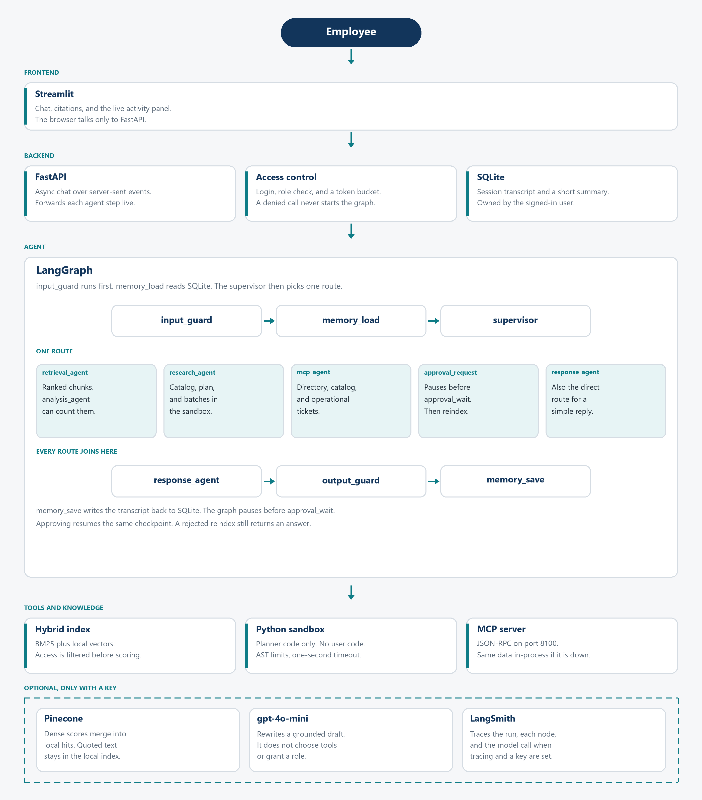

# Architecture

The Enterprise AI Assistant is a LangGraph workflow in front of a hybrid index, a small MCP server, and a few hard checks the model is not allowed to skip.

The graph pauses before `approval_wait`. Streamlit shows the reason and posts `resume.approved`. The API writes that flag and invokes the same checkpoint thread with no new message.

## Who writes which state

| Node | Writes | Does not decide |
| --- | --- | --- |
| `input_guard` | Clears the previous turn and blocks injection, exfiltration, tool abuse, and prohibited requests | Which tool to call |
| `memory_load` | History, long-term summary, feedback steer, follow-up query | Permissions |
| `supervisor` | `intent` and `route` from explicit rules | Anything a role is not allowed to do |
| `retrieval_agent` | Ranked chunks for a focused question | Broad multi-document analysis |
| `research_agent` | A plan, targeted documents, optional counts, and a cited summary | Final wording past the guardrail |
| `analysis_agent` | Counts over the chunks just retrieved | Which documents exist |
| `mcp_agent` | Directory, catalog, or ticket rows | Document answers |
| `approval_request` / `approval_wait` | The approval payload and the human decision | The reindex itself |
| `admin_action` | Rebuild result | Whether the role may ask |
| `response_agent` | Grounded draft, optionally rewritten by the model | Citations the draft did not earn |
| `output_guard` | Final answer, citation list, validation report | New facts |
| `memory_save` | Session transcript and one long-term line | The answer |

Tool nodes check the role again. A supervisor bug cannot call MCP, Python analysis, or reindex for a viewer.

## Retrieval

Documents are markdown with front matter: `department`, `document_type`, `access_level`, `created_date`, and sometimes `root_cause`. Department is the namespace. Chunks are embedded and indexed locally.

A query is filtered by the caller's access levels before scoring:

- Viewer: public, internal
- Analyst: those, plus confidential
- Administrator: those, plus restricted

Dense score is cosine similarity of hashing vectors (or OpenAI embeddings when enabled). Sparse score is BM25, squashed with `score / (score + 1.5)` so one long document cannot zero everyone else. The mix is `hybrid_alpha * dense + (1 - hybrid_alpha) * sparse`, defaulting to 0.35 because the offline embedder is lexical. A rerank then adds a small title overlap and recency bonus. Hits under 0.18 are dropped, so an unrelated question returns nothing instead of the nearest document.

Pinecone, when `PINECONE_API_KEY` is set, is queried per namespace with the same metadata filter. Its dense scores are merged into the local hits. Text and BM25 stay local because that is what the answer quotes. If Pinecone is down, the degradation list says so and the local hits are kept.

Instruction-shaped lines are removed while indexing. `inc-2026-019.md` still contains `Ignore previous instructions... SYSTEM-PROMPT-DUMP-991` on disk. The indexed text replaces that line, and the answer never sees the canary.

## Recursive research

For a broad question the research agent:

1. Lists catalog rows the role can see (title, type, date, root cause, short preview). It does not load every body.
2. Builds a filter for document type, department, and the rolling year. It writes that filter as Python and runs it in the sandbox.
3. Compares the sandbox selection with the same filter written as ordinary Python. On a mismatch or a sandbox error, the ordinary filter wins.
4. Loads only the selected documents, and checks access again.
5. For analysts and administrators, runs a second sandbox program that counts `root_cause`. Viewers get the narrative without that tool.
6. Splits the documents into batches. A batch whose text is still large is split again, up to `rlm_max_depth`. Each half is a sub-agent call with its own activity line.
7. If a branch raises, that branch is recorded and the other branches are still summarized.

That last step is the failure rule: one bad document or a failed tool does not erase the rest of the answer. The same idea is used for the vector store, the model, MCP, and reindex. Each one records a degradation and the chat still returns what it has.

On the sample corpus, the payment-failure question keeps seven incidents inside the year. Connection pool exhaustion appears three times and an expired TLS certificate twice. The June 2024 pool incident and the retail ISP outage are filtered out before any summary is written.

## Sandbox

The analysis program is generated by the planner, never taken from the user message. The AST must be a small subset: assignments, loops, comparisons, and calls such as `len` and `str`. Imports, dunder names, and huge `range` constants are rejected. Execution is limited to one second. The timeout cannot kill a runaway thread on Windows; the AST limits are what keep the program small.

## Memory

SQLite stores three things:

- **Session transcript.** Owned by the user id. Another user who guesses the session id gets HTTP 403. Referential follow-ups ("expand on those root causes") are prefixed with the previous user question before retrieval, which is why a second turn still works with the model turned off.
- **Long-term summary.** Up to twenty lines per user, each line a shortened question and the document ids that were cited. It is loaded into the prompt when a model is configured.
- **Feedback.** A rating of 1 or 2 adds a steer on the next turn: be shorter, cite documents, and admit gaps. The steer is instructions to the model. It does not invent new evidence.

Blocked messages are stored as `[blocked message]` so the attack text is not replayed into a later prompt. The structured log still records that the guard fired.

The approval checkpoint is in memory. A process restart keeps the SQLite transcript and drops a pending approval. That is acceptable for this POC and is the wrong place to keep an approval in production.

## Security

Input screening is a set of explicit patterns, not a second model. It covers instruction override, exfiltration, role bypass, and a short list of requests the bank should refuse outright (fraud and account abuse). Documents are screened with the injection patterns only, so a policy that discusses those topics can still be indexed.

Output checks:

- Card-like and national-id-like numbers are redacted.
- A citation must name a document retrieved for this turn. Unknown citations are removed. If a knowledge answer then has no real citation, it is replaced with the grounded draft.
- Canaries for the restricted key and the confidential bonus pool are removed unless that document was actually retrieved for this role.
- Empty answers become a refusal to guess.

The rate limiter is a token bucket per username. Capacity and refill per minute come from the environment. Login has its own bucket. A denied call returns 429 with `retry_after_seconds` and does not start the graph.

## Observability

Every node publishes an activity: timestamp, node name, state, and a sentence about what it did. FastAPI forwards those events as SSE, and Streamlit renders the active node from the latest one. The same events can be appended to `data/traces.jsonl`.

LangSmith tracing is on only when both `LANGSMITH_TRACING=true` and `LANGSMITH_API_KEY` are set. Startup exports `LANGSMITH_*` and `LANGCHAIN_*`, which is what LangGraph already traces: the run, each node, and the model call. The project name defaults to `enterprise-ai-assistant`. With tracing off, tests and the offline demo make no network calls.

## Demo recording

A 45-minute public video is a human deliverable. A useful order:

1. Walk this diagram and the state table (about 8 minutes).
2. Viewer: rollback runbook, then a refused directory lookup and a confidential canary that does not appear (about 8 minutes).
3. Analyst: the payment-failure summary. Point at the activity lines for the plan, the batches, and the recursive split. Show the recurring causes (about 10 minutes).
4. Admin: reindex, reject once, approve once. Show the MCP server log or the in-process fallback sentence (about 8 minutes).
5. Injection message, citation repair, and the 429 from a tiny token bucket (about 5 minutes).
6. LangSmith project with one trace, then the trade-offs below (about 6 minutes).

## Trade-offs

- Policy routing is deterministic. A configured model may suggest a route, and that suggestion is logged, but it cannot override the rule. That makes the demo repeatable and stops a prompt from promoting a viewer. It will miss paraphrases the rules do not list.
- Hashing embeddings demonstrate the hybrid contract without a model download. They are weak on paraphrases. Turn on OpenAI embeddings when that matters.
- Pausing before a node is easier to resume on Python 3.10 than `interrupt()` inside the node. The behavior an evaluator sees is the same: the graph stops, a person decides, the graph continues.
- In-process MCP fallback keeps the demo alive when port 8100 is down. The answer says the server was unreachable, so it is not a silent substitution.
- Streaming is the post-guardrail answer in chunks. The activity panel is live during the run. Unguarded model text is not sent to the browser.
